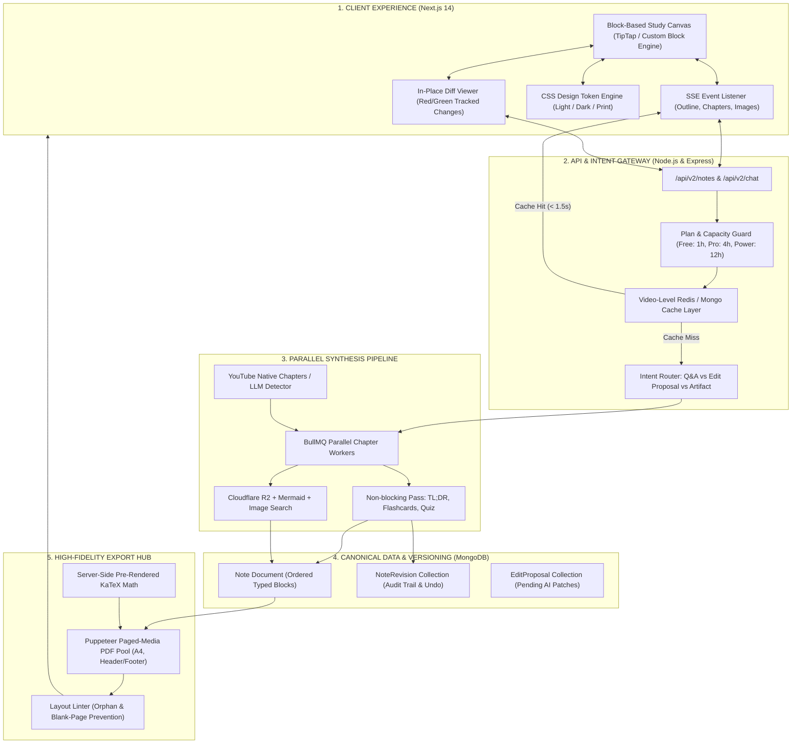
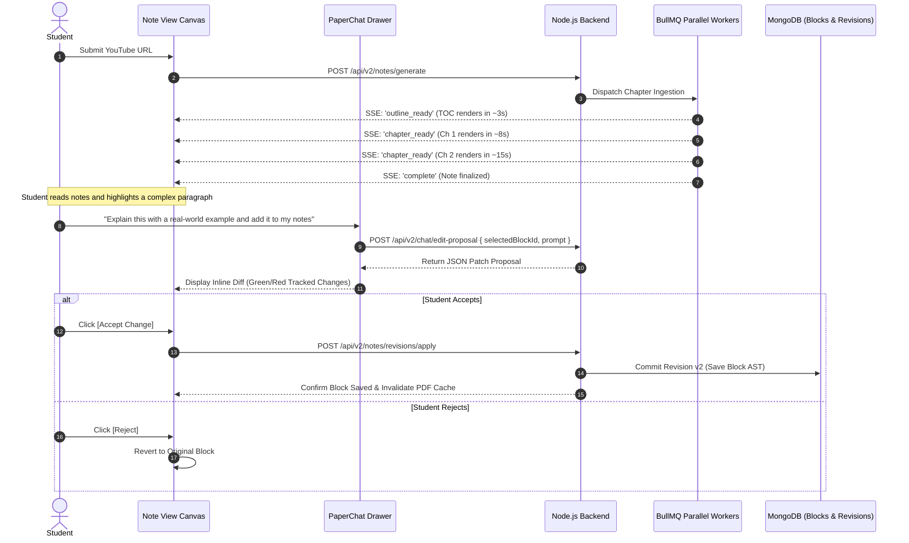

# Paperxify 2.0 — Architecture & System Design Blueprint

> **Document ID:** `01_paperxify_2.0_architecture.md`  
> **Status:** Production Architecture Specification  
> **Target Release:** Paperxify v2.0  
> **Last Updated:** November 2026  

---

## 1. Vision & Core Philosophy

Paperxify 2.0 is an evolution from a **static YouTube-to-Markdown summarizer** into an **autonomous, block-based interactive learning canvas**. 

Students should not merely watch a lecture and receive a frozen wall of text. They should be able to:
1. **Experience instant streaming**: See the lecture outline in 3 seconds and read Chapter 1 in 8 seconds.
2. **Collaborate with AI directly on the canvas**: Use PaperChat to propose edits, add real-world analogies, or generate comparison tables directly inside the document.
3. **Switch themes without touching content**: View and study in high-contrast Dark Mode, clean Blueberry, or Oxford Academic.
4. **Export textbook-grade PDFs**: Download print-ready, vector-sharp PDFs with zero blank pages, running headers, and pristine KaTeX math.

---

## 2. Architectural Comparison: 1.0 vs 2.0

| Capability | Paperxify 1.0 (Current) | Paperxify 2.0 (Target) |
| :--- | :--- | :--- |
| **Document Storage** | Monolithic `content: String` (Markdown blob) | Ordered array of typed `DocumentBlock` objects (JSON AST) |
| **Generation Pipeline** | Serial 7-layer pipeline with single massive Layer 6 call | Parallel per-chapter map-reduce with SSE outline & chapter streaming |
| **Perceived Speed** | 45s – 90s blank spinner before any content appears | **< 3s** outline visible, **< 8s** Chapter 1 readable, **< 30s** complete |
| **Caching** | None (same video paid repeatedly across users) | **Video-level multi-tenant cache** (Video ID + Language + Tier) |
| **PaperChat Role** | Passive read-only Q&A in separate drawer | **In-place AI Editor** (Cursor / Notion AI style proposal & diff patches) |
| **PDF Generation** | Secondary LLM prompt generating unmanaged inline HTML | **Native CSS Paged-Media print renderer** with headless Chromium pool |
| **Visuals & Icons** | Unverified images block generation; emojis in headings | **SVG icons**, Mermaid auto-recoloring, non-blocking background images |
| **Math Rendering** | Client-side KaTeX rendering (layout shift on load) | **Server-Side Rendered (SSR) KaTeX** injected directly into DOM |
| **Versioning & Undo** | No revision tracking; edits overwrite note | Full **NoteRevision history** with one-click rollback & undo |

---

## 3. High-Level System Architecture

---

## 4. The Five Architectural Pillars

### Pillar 1: The Block-Based Document Schema
The central structural reform is storing every note as an ordered list of typed blocks.
- **Why this matters**:
  - The AI can target a single block (e.g., `replace_block: "blk_04"`) rather than regenerating 15 pages of text.
  - Themes apply styles through CSS tokens rather than hardcoded Markdown markdown markers.
  - PDF page-breaking rules (`break-inside: avoid`) can be cleanly applied to individual blocks.
- **Detailed Specification**: See [`02_block_document_engine.md`](file:///c:/Users/Om%20Awchar/Documents/paperxify/implementation/02_block_document_engine.md).

---

### Pillar 2: Sub-30s Parallel Streaming Pipeline
Instead of running a single sequential pipeline:
1. **Multi-Tenant Cache Check**: If another student has already processed this lecture in the same language and detail tier, the note returns in **< 1.5 seconds**.
2. **Chapter-Aligned Partitioning**: Video transcripts are divided at logical chapter boundaries rather than arbitrary character cuts.
3. **Parallel Chapter Extraction & Writing**: BullMQ workers process all chapters concurrently.
4. **Server-Sent Events (SSE) Streaming**:
   - `03s`: Emit `OUTLINE_READY` (Full Table of Contents renders).
   - `08s`: Emit `CHAPTER_1_READY` (Student starts reading while Chapter 2 generates).
   - `18s`: Emit `CHAPTER_2_READY`.
   - `28s`: Emit `NOTE_COMPLETE`.
5. **Non-Blocking Visuals**: The text renders with fixed-dimension placeholder frames. Diagram URLs stream in later without causing layout shift.

---

### Pillar 3: PaperChat as an In-Place AI Editor
PaperChat evolves from a chatbot into a **collaborative editor** (similar to Cursor and Notion AI):
1. **Selection Context**: The student highlights a section of text on their note canvas.
2. **Intent Classification**: A lightweight classifier determines whether the student wants an explanation or a document change.
3. **Structured Patch Proposal**: If an edit is requested, PaperChat returns a JSON patch with operations:
   - `replace_block`
   - `insert_block_after`
   - `delete_block`
   - `edit_text_range`
4. **Interactive In-Place Diff**: The UI renders red and green tracked changes directly inside the note block.
5. **Human in the Loop**: The student reviews the diff and clicks **[Accept]** or **[Reject]**. Accepted changes are saved with full undo/redo versioning.
- **Detailed Specification**: See [`03_paperchat_ai_editor.md`](file:///c:/Users/Om%20Awchar/Documents/paperxify/implementation/03_paperchat_ai_editor.md).

---

### Pillar 4: Native Paged-Media PDF Engine
Replaces the flawed LLM HTML generator with a **deterministic paged print renderer**:
- **CSS Paged Media**: Enforces `@page` standards with `size: A4 portrait`, running top headers with chapter names, and running bottom page counters (`Page X of Y`).
- **Break Control**: Eliminates awkward page cuts using `break-inside: avoid` on tables, callout boxes, and formulas.
- **Zero Blank Pages**: A layout linter checks page heights and shrinks oversized tables or moves orphaned headings to avoid empty gaps.
- **Server-Side KaTeX & Inline SVGs**: Math and callout icons are pre-rendered into SVG vectors, ensuring vector sharpness at 300 DPI.
- **Detailed Specification**: See [`04_paged_pdf_export_engine.md`](file:///c:/Users/Om%20Awchar/Documents/paperxify/implementation/04_paged_pdf_export_engine.md).

---

### Pillar 5: Tokenized Theming & Subject Blueprints
- **Design Tokens**: Complete separation of content and visuals. Themes (Academic, Blueberry, Midnight, Emerald) define colors, fonts, and spacings without altering block JSON.
- **Subject Blueprints**:
  - **Computer Science**: Emphasizes syntax-highlighted code blocks and algorithm complexity ($O(n \log n)$).
  - **Mathematics / Physics**: Emphasizes formal derivations, KaTeX display equations, and variable legends.
  - **Medicine / Biology**: Emphasizes anatomical/process flowcharts, mnemonics, and terminology definitions.
  - **Business / Commerce**: Emphasizes comparative tables, key financial metrics, and executive summaries.

---

## 5. End-to-End Generation & Review Workflow

---

## 6. Implementation Deliverables & Documentation Index

All architectural components are documented across the following implementation guides:

1. [`00_project_overview.md`](file:///c:/Users/Om%20Awchar/Documents/paperxify/implementation/00_project_overview.md) — Baseline Analysis & Codebase Auditing
2. [`01_paperxify_2.0_architecture.md`](file:///c:/Users/Om%20Awchar/Documents/paperxify/implementation/01_paperxify_2.0_architecture.md) — (This Document) Master Architecture Specification
3. [`02_block_document_engine.md`](file:///c:/Users/Om%20Awchar/Documents/paperxify/implementation/02_block_document_engine.md) — Block Data Schema, Models & Legacy Converter
4. [`03_paperchat_ai_editor.md`](file:///c:/Users/Om%20Awchar/Documents/paperxify/implementation/03_paperchat_ai_editor.md) — Proposal-and-Patch Protocol & Diff Editor UI
5. [`04_paged_pdf_export_engine.md`](file:///c:/Users/Om%20Awchar/Documents/paperxify/implementation/04_paged_pdf_export_engine.md) — Paged-Media PDF Architecture & Layout Linter
6. [`05_implementation_roadmap.md`](file:///c:/Users/Om%20Awchar/Documents/paperxify/implementation/05_implementation_roadmap.md) — Phased Implementation & Migration Roadmap

