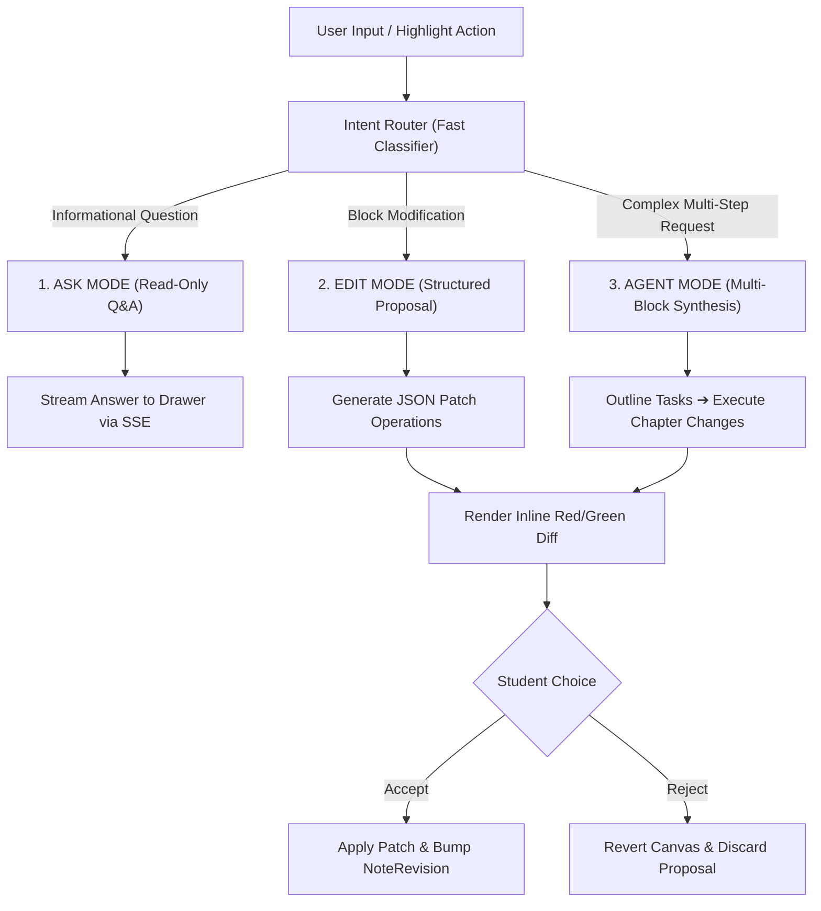

# Paperxify 2.0 — PaperChat In-Place AI Editor Specification

> **Document ID:** `03_paperchat_ai_editor.md`  
> **Status:** Production Specification & API Contract  
> **Target Release:** Paperxify v2.0  
> **Last Updated:** November 2026  

---

## 1. Executive Summary & Vision

In Paperxify 1.0, PaperChat functioned exclusively as a **read-only question-answering assistant** in a side drawer. When a student asked the AI to *"explain this simply"* or *"add a comparison table"*, the generated content remained trapped in the chat log, forcing the student to manually copy and reformat it.

**Paperxify 2.0 turns PaperChat into an in-place AI editor** inspired by **Cursor**, **Notion AI**, and **Revise**. 
Students can select any block on their canvas, ask PaperChat to modify or expand it, review visual **red/green tracked changes**, and click **[Accept]** or **[Reject]** with full version control.

```
┌────────────────────────────────────────────────────────────────────────┐
│  CHAPTER 2: LOSS FUNCTIONS & GRADIENTS                                 │
├────────────────────────────────────────────────────────────────────────┤
│  [Proposed AI Change · Revision v4]                                    │
│                                                                        │
│  - [-Backpropagation calculates the analytical gradient of the loss-] │
│  + {+Backpropagation is simply calculating how much each neuron+}      │
│  + {+contributed to the final error...+}                               │
│                                                                        │
│  ┌─ ⚡ Real-World Analogy ───────────────────────────────────────────┐ │
│  │ Think of backpropagation like adjusting your basketball shot...   │ │
│  └───────────────────────────────────────────────────────────────────┘ │
│                                                                        │
│  [ ✓ Accept Changes ]   [ ✕ Reject ]   [ 💬 Refine with PaperChat ]     │
└────────────────────────────────────────────────────────────────────────┘
```

---

## 2. The Three Interaction Modes



1. **Ask Mode (Read-Only Q&A)**:
   - For exploratory questions: *"What is the difference between L1 and L2 regularization?"*
   - Returns grounded answers to the chat drawer without modifying the canvas.
2. **Edit Mode (Targeted Block Proposal)**:
   - For specific block modifications: *"Make this paragraph simpler"*, *"Add a variable legend to this equation"*, or *"Convert this bullet list into a 3-column comparison table"*.
   - Proposes structured patch operations with an inline diff.
3. **Agent Mode (Multi-Block Transformation)**:
   - For sweeping structural tasks: *"Re-organize Chapter 3 into 4 subsections"*, *"Scan my notes for missing concepts covered in the video and add them"*, or *"Generate a comprehensive exam formula cheat sheet at the bottom"*.

---

## 3. The Proposal-and-Patch Protocol

### 3.1. Technical Principle
The AI engine **never overwrites raw text directly**. Instead, it generates a typed **`EditProposal`** containing discrete, atomic operations validated against existing block IDs.

### 3.2. JSON Patch Schema
```json
{
  "type": "edit_proposal",
  "proposalId": "prop_8a2f4c91",
  "noteId": "6724fa10b...",
  "baseVersion": 4,
  "summary": "Replaced technical jargon with a real-world intuition analogy and inserted a formula callout",
  "operations": [
    {
      "op": "replace_block",
      "blockId": "blk_ch2_04",
      "before": "Backpropagation calculates the analytical gradient of the loss function with respect to weights...",
      "after": "Backpropagation is calculating how much each neuron contributed to the final prediction error...",
      "reason": "Improved conceptual clarity"
    },
    {
      "op": "insert_block_after",
      "targetBlockId": "blk_ch2_04",
      "block": {
        "id": "blk_ch2_05_callout",
        "chapterId": "ch_2",
        "type": "callout",
        "data": {
          "variant": "remember",
          "title": "Core Intuition",
          "content": "Think of backpropagation like adjusting a shower dial: if the water is too cold, you turn the knob proportionally warmer."
        }
      }
    }
  ],
  "sourceReferences": [
    {
      "startSeconds": 312,
      "endSeconds": 360,
      "formatted": "05:12 - 06:00"
    }
  ]
}
```

### 3.3. Supported Operations
| Operation (`op`) | Parameters Required | Description |
| :--- | :--- | :--- |
| `replace_block` | `blockId`, `before`, `after`, `reason` | Modifies the content or structure of an existing block. |
| `insert_block_after`| `targetBlockId`, `block` (DocumentBlock) | Inserts a new block directly beneath a specified block. |
| `delete_block` | `blockId`, `reason` | Removes an obsolete or redundant block. |
| `edit_text_range` | `blockId`, `startOffset`, `endOffset`, `replacement` | Performs fine-grained inline word substitution inside a paragraph. |

---

## 4. Frontend User Experience & Diff UI

### 4.1. Text Selection Floating Toolbar
When a student highlights text inside any block, a contextual toolbar appears directly above the cursor:
```
┌────────────────────────────────────────────────────────────────────────┐
│  [ 💡 Simplify ]  [ 🔍 Expand ]  [ 📊 Make Table ]  [ 🧮 Add Formula ] │
│  [ ⚡ Add Analogy ] [ 🎯 Exam Tip ] [ ✏️ Custom Instruction... ]       │
└────────────────────────────────────────────────────────────────────────┘
```

### 4.2. In-Place Tracked Changes (Diff Rendering)
When an `edit_proposal` is received:
1. The target block enters **Diff Mode**.
2. Deletions are highlighted with a soft red strikethrough background (`bg-red-500/10 text-red-500 line-through`).
3. Insertions are highlighted with a soft green background (`bg-emerald-500/10 text-emerald-600 font-medium`).
4. Action buttons anchor beneath the block:
   - **`[ ✓ Accept Change ]`** (`Enter` shortcut): Applies the patch to the document AST, increments the note revision, and persists to the server.
   - **`[ ✕ Reject ]`** (`Escape` shortcut): Discards the proposal and restores the original block without server roundtrips.
   - **`[ 💬 Refine ]`**: Sends a follow-up prompt to PaperChat: *"Keep the basketball analogy, but also include the mathematical formula."*

---

## 5. Backend REST API Endpoints

### 5.1. Generate Edit Proposal
- **Endpoint**: `POST /api/v2/chat/edit-proposal`
- **Headers**: `Authorization: Bearer <JWT>`, `Content-Type: application/json`
- **Request Body**:
```json
{
  "noteId": "6724fa10b...",
  "selectedBlockIds": ["blk_ch2_04"],
  "selectedText": "Backpropagation calculates the analytical gradient...",
  "prompt": "Explain this with a real-world example and add it to my notes",
  "baseVersion": 4
}
```
- **Response** (HTTP 200):
```json
{
  "success": true,
  "proposal": {
    "proposalId": "prop_8a2f4c91",
    "summary": "Added real-world analogy and simplified wording",
    "operations": [ ... ]
  }
}
```

### 5.2. Apply Proposal (Commit Revision)
- **Endpoint**: `POST /api/v2/notes/revisions/apply`
- **Request Body**:
```json
{
  "noteId": "6724fa10b...",
  "proposalId": "prop_8a2f4c91",
  "baseVersion": 4,
  "operations": [ ... ]
}
```
- **Execution Logic**:
  1. Verifies that the note's current version equals `baseVersion` (prevents race collisions).
  2. Applies the block transformations in order.
  3. Creates a new record in `NoteRevision` collection (`version: 5`).
  4. Invalidates the cached PDF for this note.
  5. Returns HTTP 200 with updated note version and block list.

### 5.3. One-Click Rollback / Undo
- **Endpoint**: `POST /api/v2/notes/revisions/rollback`
- **Request Body**:
```json
{
  "noteId": "6724fa10b...",
  "targetVersion": 3
}
```
- **Execution Logic**:
  Restores the snapshot stored in `NoteRevision` where `version == targetVersion` and increments the active version.

