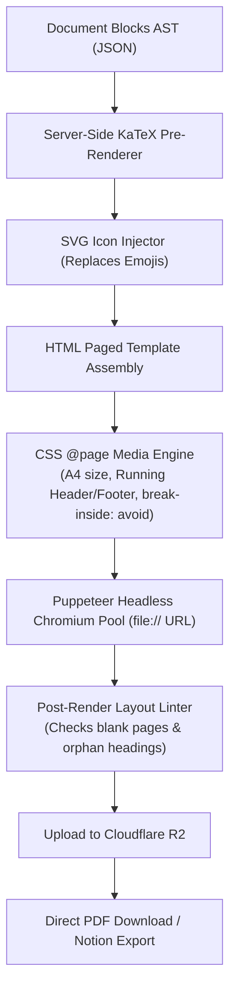

# Paperxify 2.0 — Vector-Grade Paged PDF Export Engine

> **Document ID:** `04_paged_pdf_export_engine.md`  
> **Status:** Production Specification & Print Pipeline Contract  
> **Target Release:** Paperxify v2.0  
> **Last Updated:** November 2026  

---

## 1. Executive Summary & Root Cause Analysis

In Paperxify 1.0, PDF export was implemented in [`noteController.js:385`](file:///c:/Users/Om%20Awchar/Documents/paperxify/Server/src/controllers/noteController.js#L385) via `generatePDFContent()`. This function invoked Gemini to write raw HTML with inline CSS.

### Flaws of the 1.0 Approach:
1. **Unpredictable Page Breaks**: Formulas and comparative tables were regularly sliced across page seams (e.g., top half of a table on page 3, bottom half on page 4).
2. **Awkward Blank Pages**: Random `<div>` margins generated by the LLM forced unnecessary page overflows, leaving massive white gaps.
3. **Emoji Rendering Failures**: System emojis (⚡, 🔴, ⚠️) rendered as broken or missing glyphs in Linux/Render cloud containers.
4. **Doubled Cost & Latency**: Generating a PDF required a secondary LLM call (15–25s delay) and cost hundreds of thousands of tokens per month.

### The Paperxify 2.0 Solution:
Paperxify 2.0 builds a **deterministic, native CSS Paged-Media print renderer** operating directly on the canonical Document Blocks. No secondary LLM generation is required.

---

## 2. Paged-Media Print Architecture



---

## 3. CSS Paged Media Standard (`@page`)

The export engine utilizes W3C CSS Paged Media Module specifications to format the document as a published physical book:

```css
/* Print Media Rules */
@page {
  size: A4 portrait;
  margin: 22mm 16mm 20mm 16mm;

  /* Running Header (Top Margin Box) */
  @top-left {
    content: "Paperxify Academic Lecture Series";
    font-family: 'Plus Jakarta Sans', sans-serif;
    font-size: 8pt;
    font-weight: 500;
    color: #64748b;
    border-bottom: 0.5pt solid #e2e8f0;
    padding-bottom: 4px;
  }

  @top-right {
    content: string(chapter-title);
    font-family: 'Plus Jakarta Sans', sans-serif;
    font-size: 8pt;
    font-weight: 600;
    color: #0f172a;
    border-bottom: 0.5pt solid #e2e8f0;
    padding-bottom: 4px;
  }

  /* Running Footer (Bottom Margin Box) */
  @bottom-left {
    content: "Source: Verified YouTube Lecture";
    font-size: 8pt;
    color: #94a3b8;
  }

  @bottom-right {
    content: "Page " counter(page) " of " counter(pages);
    font-family: 'Inter', sans-serif;
    font-size: 8pt;
    font-weight: 600;
    color: #475569;
  }
}

/* First Page (Cover) has no headers or footers */
@page:first {
  margin: 0;
  @top-left { content: none; }
  @top-right { content: none; }
  @bottom-left { content: none; }
  @bottom-right { content: none; }
}
```

---

## 4. Break Control & Blank-Page Elimination

To guarantee that tables, formulas, and diagrams are never cut in half:

```css
/* Keep headings attached to their succeeding block */
h1, h2, h3, h4 {
  break-after: avoid !important;
  page-break-after: avoid !important;
}

/* Never break inside critical pedagogical components */
.formula-card,
.callout-box,
.table-wrapper,
.code-block,
.diagram-container,
.worked-example-card {
  break-inside: avoid !important;
  page-break-inside: avoid !important;
  margin-top: 12pt;
  margin-bottom: 12pt;
}

/* Prevent 1-line orphan/widow sentences */
p, li {
  orphans: 3;
  widows: 3;
}
```

---

## 5. Server-Side KaTeX & SVG Icon Resolution

### 5.1. Pre-Rendered KaTeX Math
Instead of loading client-side JavaScript inside Puppeteer to render math equations, equations are compiled to static HTML/MathML strings on the server:

```javascript
const katex = require("katex");

function renderFormulaBlockToHTML(formulaBlock) {
  const html = katex.renderToString(formulaBlock.data.latex, {
    displayMode: formulaBlock.data.displayMode !== false,
    throwOnError: false,
    output: "htmlAndMathml"
  });

  let legendHtml = "";
  if (formulaBlock.data.variableLegend?.length > 0) {
    legendHtml = `
      <div class="variable-legend">
        ${formulaBlock.data.variableLegend.map(v => 
          `<span class="legend-item"><strong>${v.symbol}</strong>: ${v.meaning}</span>`
        ).join(" · ")}
      </div>
    `;
  }

  return `
    <div class="formula-card">
      <div class="formula-math">${html}</div>
      ${legendHtml}
    </div>
  `;
}
```

### 5.2. Inline Vector SVG Icons (Replacing Emojis)
All emojis are mapped to crisp, 300-DPI SVG icons:
- `⚡ Quick Remember` ➔ `<svg class="icon-zap">...</svg>` (Emerald/Amber fill)
- `🔴 Must-Know` ➔ `<svg class="icon-target">...</svg>` (Crimson fill)
- `⚠️ Misconception` ➔ `<svg class="icon-alert">...</svg>` (Amber fill)
- `🎯 Exam Tip` ➔ `<svg class="icon-award">...</svg>` (Indigo fill)

---

## 6. Cover Page & Table of Contents with PDF Bookmarks

### 6.1. Cover Page Elements
Every exported PDF includes an academic cover layout:
1. **Lecture Title**: Large, high-contrast typography in the selected theme font.
2. **Video Metadata Badge**: Channel name, duration, date generated, and unique document slug.
3. **High-Res Video Thumbnail**: Displayed with rounded borders and subtle drop shadow.
4. **Dynamic QR Code**: Scannable QR code encoding the exact YouTube lecture URL so students can scan and watch the source video from physical printed paper.

### 6.2. Hyperlinked PDF Bookmarks
The export compiler generates a native **Table of Contents (TOC)** with internal anchor links (`#ch_1`, `#ch_2`), allowing PDF readers (Adobe Acrobat, Apple Books, Chrome PDF viewer) to display interactive navigation bookmarks in the side panel.

---

## 7. Automated Layout Linter (Zero Blank Pages)

Before finalizing the PDF, a layout verification script checks the rendered DOM:
1. **Orphan Header Detection**: Checks if any `<h2>` or `<h3>` sits within 40px of the page bottom boundary. If detected, automatically applies `break-before: page`.
2. **Table Width Bounds**: If a comparison table exceeds the maximum page width, the linter applies a `compact-table` CSS class with reduced font size and cell padding.
3. **Empty Page Removal**: Detects whether page height contains zero content elements and purges the page before writing the final PDF file buffer.

---

## 8. Export Options & Presets

Students can customize their export via the download dialog:
- **Format Presets**:
  - **Textbook Standard** (Comfortable line spacing, complete diagrams, full derivations).
  - **Exam Cheat Sheet** (Two-column layout, compact density, formula boxes and exam tips only).
  - **Ink-Saver Mode** (Pure black-and-white vector mode with zero background fills to save printer toner).
- **Theme Selection**: Oxford Academic, Blueberry Studio, Emerald Scholar, or Monochrome.

